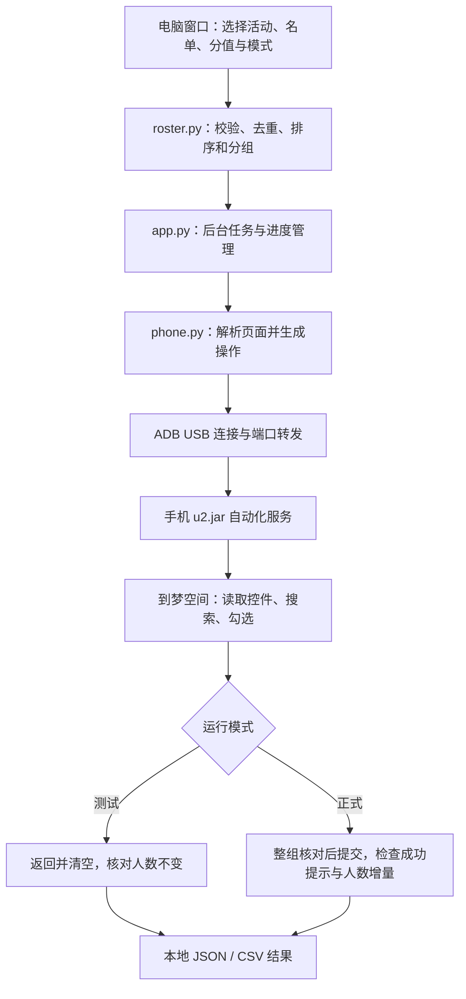

[README.md](https://github.com/user-attachments/files/34232013/README.md)
# 到梦空间学分助手

面向活动管理工作的 Windows 桌面辅助工具，通过 USB 调试连接 Android 手机，在到梦空间内完成活动定位、名单搜索、人员勾选与发分流程辅助。

软件将原本需要手动输入路径、反复搜索和核对的过程整理为四步窗口：**连接手机 → 选择活动与名单 → 核对任务 → 运行与结果**。支持按姓氏批量搜索、按学号逐人搜索，以及默认开启的测试模式。

> 当前版本：校徽版，说明更新于 2026 年 11 月 1 日。正式发分逻辑已实现，但提交确认弹窗、成功提示和人数增量尚未完成真机核验；目前应作为实验性功能对待。


## 一、软件的意义

活动结束后的学分发放，往往需要管理人员对照 Excel 名单，在手机中重复搜索、查找、勾选和核对。人数较多时，这些操作既耗时，也容易因同名、重复名单或活动日期相近而出错。

本软件希望把重复操作交给程序，把活动选择、名单检查和结果判断保留为清晰可见的步骤：

- **减少重复劳动**：同姓人员可共用一次搜索条件，程序逐屏查找并勾选名单中的目标人员。
- **降低上手门槛**：用按钮、文件选择框和分步提示代替手动输入路径；通过日志和进度条了解当前状态。
- **先演练再操作**：测试模式可以先验证活动导航、搜索和勾选过程，不实际提交学分。
- **便于核对和交接**：保存任务信息、逐人结果和名单异常，方便事后核查。

软件是管理流程的辅助工具。应发人员和分值由管理人员提供，到梦空间账号的活动权限仍由手机端决定。

## 二、主要功能

| 功能 | 当前实现 |
| --- | --- |
| 可视化操作 | 四步窗口、大字提示、文件选择、分组预览、进度条和实时日志 |
| 手机连接 | 检测已授权设备，自动部署并启动本次 UI 自动化服务、建立端口转发 |
| 活动读取 | 读取手机“管理”列表中的已结束活动，遇到第一个已完结活动停止 |
| 活动定位 | 根据用户选择的活动标题、时间和状态进行核对 |
| 名单导入 | 支持一份或多份 `.xlsx`，每份表格设置一个分值 |
| 姓氏模式 | 先按姓氏拼音整理，再将同姓人员按学号升序排列；手机搜索姓氏并核对完整姓名 |
| 学号模式 | 在手机搜索完整学号，再核对姓名 |
| 名单检查 | 校验姓名、学号和分值，处理重复学号与身份冲突 |
| 测试模式 | 搜索、勾选、核对后清空，不提交学分；默认演练前三组，可调整组数 |
| 正式模式 | 实验性功能；整组完整匹配后提交，核对成功提示和已颁发人数增量 |
| 任务控制 | 暂停、继续、停止；任务运行期间锁定测试/正式模式切换 |
| 结果记录 | 保存任务 JSON、逐人结果 CSV 和名单异常 CSV |
| 故障诊断 | 在本机保存近期页面、点击记录、错误信息及可取得的手机截图 |
| 窗口标识与致谢 | 使用用户提供的南华大学校徽；右下角致谢可展开、收起，不阻塞任务 |

自动配置覆盖连接后的服务部署和通信准备。手机解锁、USB 调试授权、到梦空间登录及活动权限仍需本人完成。

## 三、两种搜索方式

### 1. 按姓氏批量搜索

先整理电脑名单，再操作手机：

1. 取姓名的第一个字作为搜索条件和分组依据。
2. 按姓氏拼音排列不同姓氏；对部分常见多音姓设置专门读音。
3. 同姓人员按 11 位学号升序排列。
4. 按“姓氏 + 分值”生成实际执行分组，避免不同分值混在一次提交中。
5. 手机只输入姓氏，读取搜索结果，逐屏核对完整姓名并勾选目标人员。

以下为虚构示例：

| 原名单顺序 | 姓名 | 学号 |
| --- | --- | --- |
| 1 | 蔡甲 | 20990000009 |
| 2 | 蔡乙 | 20990000002 |
| 3 | 陈丙 | 20990000001 |

整理后的计划顺序为：**蔡乙 → 蔡甲 → 陈丙**。同姓内先看学号，不按名字后面的字排列。

该顺序与当前观察到的手机端学号排序方式保持一致。不过，实际点击仍以手机当屏读到的人员为准。程序会遍历搜索列表，不会仅凭电脑排序推断某人已被跳过，也不会找到全部目标后立刻结束扫描；继续扫描有助于发现手机结果中的同名人员。

当前“姓氏”指姓名首字，未实现复姓词典识别。手机匹配主要依赖完整姓名；名单内的同名不同学号会被排除，已扫描到的手机结果出现目标同名也会停止，但这不等于对所有同名情况都能可靠区分身份。

### 2. 按学号逐人搜索

每组使用一个完整学号作为搜索条件，再核对搜索结果中的姓名。适合需要逐人确认，或不适合按姓名区分的名单。

两种方式在电脑界面中选择，不需要更换程序。

## 四、名单格式与处理规则

目前读取 `.xlsx`，不直接读取 `.xls` 或 `.csv`。每个待读取工作表的前十行内，应同时出现“姓名”和“学号”表头；其他列可以保留。

| 姓名 | 学号 |
| --- | --- |
| 蔡甲 | 20990000009 |
| 蔡乙 | 20990000002 |

- 姓名不能为空，学号须为 11 位数字。建议将学号列设为文本，保留可能存在的前导零。
- 每份表格在软件中指定一个分值；分值须大于 0，最多一位小数。当前不从表格内的分值列自动读取分数。
- 同一学号、同一姓名重复出现时，合并来源并保留最高分，**不会把分值相加**。
- 同一学号对应不同姓名时，列入异常，不参与处理。
- 姓氏模式下，同名不同学号的人员列入异常，不参与该模式的处理。
- 原表格只读，软件不覆盖或重新保存源工作簿。

导入的应是**本次实际需要发分的人员名单**。文件即使名为“录取名单”，只要字段和人员范围符合要求，也可以使用；无需再额外导入一份录取名单。

目标活动由用户在电脑活动列表中选择，程序不会根据 Excel 文件名或表格中的活动名称自动决定发哪个活动。

## 五、使用方法

### 1. 准备与连接

运行本目录中的 `到梦空间学分助手-测试版-校徽版.exe`，无需另装 Python。

1. 用支持数据传输的 USB 线连接 Android 手机和电脑，保持手机解锁。
2. 开启 USB 调试，在手机上确认本台电脑的调试授权。
3. 部分手机还需要开启“USB 调试（安全设置）”等允许模拟操作的选项；已核验的小米设备开启后还需重启。
4. 打开到梦空间，登录有目标活动管理权限的账号。
5. 点击“检测并连接手机”。当前一次只支持连接一台已授权设备。

### 2. 选择活动、名单和分值

1. 点击“读取 / 更换活动”，等待手机管理列表扫描完成。
2. 在电脑选择正确活动，核对标题、日期及上午/下午。
3. 点击“添加表格”，选择实际发分名单；需要时添加多份。
4. 为各表格设置分值，选择“按姓氏批量”或“按学号逐人”。
5. 点击“检查名单”，查看分组计划、去重情况及异常。

### 3. 核对模式并运行

顶部开关始终显示“测试（不发分） / 正式发分”。每次启动默认测试模式，切换开关本身不会开始任务。

| 项目 | 测试模式 | 正式模式（实验性） |
| --- | --- | --- |
| 实际操作手机 | 是 | 是 |
| 搜索、匹配和勾选 | 是 | 是 |
| 提交学分 | 否 | 是 |
| 处理范围 | 默认前三组，可调整 | 完整有效名单 |
| 缺少部分人员 | 记录找到和未找到人员，清空勾选 | 整组不提交，记录后继续下一组 |
| 每组收尾 | 取消临时勾选，核对已颁发人数不变 | 成功需同时核对提示人数和已颁发人数增量 |

点击核对页的“仅演练勾选”或“开始正式发分”后，会要求选择结果保存文件夹。**选择文件夹后即开始对应任务；取消选择则不开始。**

运行时不要同时手动操作手机。测试模式并非离线预览，它会真实进入页面、搜索、勾选，再返回并清空。

### 4. 查看进度与结果

运行页显示当前分组、处理进度、已验证勾选人数、已确认发分人数和操作日志。进度达到 100% 表示计划中的人员已处理，不表示所有人员都已发分，仍应查看逐人结果。

支持暂停、继续和停止。停止不能撤回已经发出的学分；若提交已经发生，程序会先完成必要的本组结果核对。关闭窗口也需等待当前操作及清理结束。

## 六、通过什么技术实现

### 技术栈

| 技术或组件 | 用途 |
| --- | --- |
| Python | 名单处理、流程调度、手机通信和结果保存 |
| Tkinter / ttk | Windows 图形窗口、按钮、表格、进度条和文件选择框 |
| openpyxl 3.1.5 | 只读解析 Excel 工作簿 |
| pypinyin 0.55.0 | 将姓氏转换为拼音，辅助名单排序 |
| Decimal | 表示和校验分值，避免使用二进制浮点数直接处理分值 |
| Android SDK Platform Tools / ADB | 发现设备、部署手机服务、建立 USB 通信通道 |
| uiautomator2 的 u2.jar | 在手机端读取界面控件，执行点击、输入、按键和滑动 |
| urllib.request / JSON-RPC | 电脑端向手机自动化服务发送控制请求 |
| ElementTree | 解析手机返回的页面 XML，定位活动、搜索框和人员行 |
| threading / queue | 后台执行手机操作，通过消息队列更新界面 |
| PyInstaller 6.22.3 | 将 Python 程序、依赖和运行资源打包成 Windows EXE |

桌面控制器使用 Python 标准库直接调用 JSON-RPC，不依赖安装完整的 `uiautomator2` Python 客户端。手机运行组件取自其发行包。

### 通信与执行流程



连接时，`phone.py` 先通过 `adb devices` 找到已授权手机，将 `u2.jar` 放入手机临时目录，再用 Android 的 `app_process` 启动独立服务。手机服务监听 19009 端口，电脑通过 `adb forward tcp:0 tcp:19009` 映射到本机分配的端口。

之后，电脑向本机映射端口发送 JSON-RPC 请求，例如：

- `dumpWindowHierarchy`：读取当前界面，返回 XML 控件树。
- `setText`：向已定位的搜索框写入姓氏或学号。
- `click`：点击核验后的控件区域。
- `swipe`：在列表区域内向上滑动手势，向后浏览列表。
- `pressKey`：触发搜索或返回。
- `getLastToast`：读取手机提示，供正式模式核对提交结果。

程序主要根据控件的 `resource-id`、文字、可用状态、边界和层级关系识别页面，**不是以截图 OCR 作为主流程识别方式**。点击坐标根据当前控件边界计算；积分卡片会向上寻找对应的可点击容器，而非始终使用固定屏幕坐标。

这是一套操作手机界面的自动化流程。程序本身不直接修改到梦空间数据库，也不通过到梦空间业务接口绕过手机界面提交学分。

### 手机上实际经过哪些页面

```text
我的 → 我的活动 → 管理
  → 按所选标题、时间和“已结束”状态定位活动
  → 管理活动 → 学分管理
  → 对应分值的积分卡片 → 底部“颁发”入口
  → 人员选择页 → 搜索姓氏或学号 → 核对并勾选
```

“进入人员选择页的颁发入口”与“提交已选人员的颁发 N 人”是不同步骤。测试模式允许进入选择页，但禁止提交已选人员。

读取活动时，只收集“已结束”活动，遇到首个“已完结”停止。该规则依赖当前管理列表顺序；未遇到停止标记且列表不再变化时会报错，不把不完整扫描当作成功。回到列表顶部通过退出、重新进入管理页完成，不使用反向拖动触发下拉刷新。

搜索人员时，等待结果稳定后再勾选；每次勾选后核对人数是否准确增加 1。翻页要求前后屏人员有重叠，减少大幅滑动导致漏行的风险。每组结束后返回学分页，再进入人员选择页，以清空临时选择并重置列表位置。

### 关键代码在哪里

| 文件 | 关键函数 | 职责 |
| --- | --- | --- |
| [app.py](源码/app.py) | `App`、`launch()`、`poll()` | 构建窗口、启动后台线程、接收状态消息 |
| [app.py](源码/app.py) | `start_rehearsal()`、`save_results()` | 调度测试或正式任务，保存逐人结果；函数名保留演练命名，但已包含两种模式 |
| [roster.py](源码/roster.py) | `prepare()`、`name_key()`、`groups_for()` | 校验名单、去重、姓氏与学号排序、按搜索条件和分值分组 |
| [phone.py](源码/phone.py) | `connect()`、`rpc()`、`snapshot()` | 连接手机、发送请求、解析当前页面 |
| [phone.py](源码/phone.py) | `management()`、`scan_activities()`、`open_activity()` | 进入管理列表、扫描并定位活动 |
| [phone.py](源码/phone.py) | `enter_score()`、`search()`、`select_group()` | 进入人员选择页、搜索、逐屏匹配和勾选 |
| [phone.py](源码/phone.py) | `clear_selection()`、`award_group()`、`clear_and_leave()` | 清空选择、受控提交、核对计数并退出 |

姓氏模式的核心排序代码为：

```python
people.sort(key=lambda p: (name_key(p.name[:1]), p.student_id))
```

学号已统一为等长的 11 位数字字符串，因此升序比较与其数值大小顺序一致，并能保留文本中的前导零。

## 七、结果文件与异常处理

每次任务创建独立结果目录，包含：

| 文件 | 内容 |
| --- | --- |
| `任务.json` | 活动标题、时间、搜索方式、组数、人数及是否允许提交 |
| `演练结果.csv` 或 `发分结果.csv` | 姓名、学号、分值、处理状态及来源 |
| `名单异常.csv` | 无效字段、身份冲突等异常及所在表格位置 |
| `故障诊断/`（出现故障时） | 近期点击记录、页面 XML、前台窗口、错误堆栈及可取得的截图 |

CSV 使用带 BOM 的 UTF-8 编码，便于 Excel 打开。结果和诊断由本地代码写入，不自动上传；其中可能含名单和页面信息，对外反馈问题前应先脱敏。

正式模式有独立的提交开关与控件核验：只有整组全部找到、勾选人数一致、搜索条件与分值信息一致时，才尝试提交。提交前先将“提交中”记录写入磁盘；提交后同时核对成功提示人数和对应积分卡片的已颁发人数增量。

若结果不明确、连接中断或反馈不符，会停止且不自动重试。“待核查（可能已提交，勿重复发分）”不等于未发分，应先核对手机与结果文件。当前没有跨次启动的自动续发或自动重发功能。

## 八、开发者运行与打包

以下命令在本 README 所在目录执行。已检查环境为 Windows 11、Python 3.13.7。

### 准备依赖和运行资源

```powershell
py -3.13 -m venv .venv
& ./.venv/Scripts/python.exe -m pip install openpyxl==3.1.5 pypinyin==0.55.0 pyinstaller==6.22.3
```

源码运行需要以下资源结构；当前源码目录附有图标，ADB 与 JAR 需另行准备：

```text
源码/
  app.py
  phone.py
  roster.py
  assets/
    app.ico
    school-emblem.png
    u2.jar
    platform-tools/
      adb.exe
      AdbWinApi.dll
      AdbWinUsbApi.dll
```

从 [Android 官方 Platform Tools](https://developer.android.com/tools/releases/platform-tools) 获取 Windows 运行组件，保留发行包内的许可说明；从 [uiautomator2 3.7.0 的 PyPI 发行包](https://pypi.org/project/uiautomator2/3.7.0/)提取 `uiautomator2/assets/u2.jar`。已使用的 ADB 版本为 37.0.1，其他版本尚未真机验证。

已核对的 `u2.jar` SHA-256：

```text
0b74e83c55f443539a9f76f5ce023a51466b764b1100e4097a897053fdfc0eb6
```

### 源码启动

```powershell
& ./.venv/Scripts/python.exe ./源码/app.py
```

### 打包为 EXE

```powershell
& ./.venv/Scripts/python.exe -m PyInstaller --noconfirm --onefile --windowed `
  --name '到梦空间学分助手-校徽版' `
  --icon './源码/assets/app.ico' `
  --add-data './源码/assets;assets' `
  --collect-data pypinyin `
  './源码/app.py'
```

输出位于 `dist/`。打包后由 `sys._MEIPASS` 定位随程序释放的资源；源码运行则读取 `app.py` 同目录的 `assets/`。打包前仅在该资源目录放入需要随程序分发的运行组件和图标。

## 九、已验证范围与当前限制

- 整理的贡献版源码已通过 42 项使用虚构名单和合成页面的自动检查，覆盖排序、去重、导航、翻页、模式限制及模拟提交等流程。
- 先前在 REDMI K80 上，使用对应源码完成三组姓氏测试：处理 30 人，验证勾选 26 人、未找到 4 人，各组清空，已颁发人数前后均为 0。这不是正式发分测试。
- 校徽版已检查两种窗口尺寸下的四页顶部布局，并完成 EXE 实际启动、图标显示和正常关闭检查。
- 正式提交确认弹窗、成功提示及人数增量尚未完成真机核验；模拟检查通过不能替代真机验证。
- 尚未完成其他手机、屏幕比例和到梦空间版本的兼容性验证。控件标识、输入法、列表顺序或页面布局变化都可能影响流程。
- 当前支持 Windows 桌面与 Android USB 调试；没有实现 iOS、无线调试、多手机并行或无人值守的跨次任务恢复。

更详细的本地记录见[核验记录](核验记录.md)；简要操作说明见[使用说明](使用说明.txt)。

## 十、项目来源与致谢

感谢原项目作者与贡献者的开源分享，让实用的想法得以延续。本桌面版沿用 Android USB 调试与 UI 自动化思路，补充可视化窗口、姓氏分组、测试模式与结果核对流程。

原项目：[tangent2pi/daomeng](https://github.com/tangent2pi/daomeng)。

感谢**南华大学易班工作站技术部、行政部，以及资环安团委**在团学工作中的付出。

也感谢每一位为团学工作付出时间与心力的同学。每一份认真与热忱，都是共同前行的力量。

界面校徽由用户提供，用作本版本的视觉标识，不代表校方官方发布或认证。第三方组件按其各自的许可使用；上游目前未附项目级 LICENSE，本说明不另行指定整个项目的授权方式。
